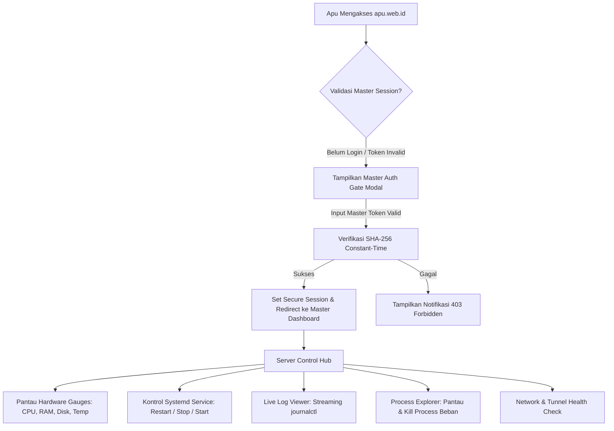

# PRD: apu.web.id Server Control & Infrastructure Management Hub

| Atribut | Detail |
| :--- | :--- |
| **Status** | Approved |
| **Author** | Antigravity (Agy) / apu |
| **Tech Lead** | apu |
| **Target Release** | Production Release (Arch Linux / Bun / systemd / Cloudflare) |
| **Versi** | v2.0 (Dedicated Server Control Edition) |

---

## 1. Executive Summary & Problem Statement

- **Background**: `apu.web.id` didedikasikan secara penuh sebagai **Server Control & Infrastructure Management Hub** pribadi untuk memantau, mengelola, dan mengorkestrasi server bare-metal (Arch Linux) serta seluruh background daemon dan network tunnel.
- **Problem Statement**:
  1. Operasi server rutin (restart daemon, inspeksi log `journalctl`, pantau utilisasi CPU/RAM/Thermal) memerlukan login SSH manual yang memakan waktu dan tidak memberikan visual overview instan saat diakses via mobile/browser.
  2. Kebutuhan antarmuka kontrol terpusat yang aman, ringan (zero-overhead), dan responsif untuk mengontrol ekosistem service (`9router`, `caddy`, `cloudflared`, `mitm-router`, bot agents).
- **Value Proposition**: Web dashboard modern Next.js 16 + Bun berlatensi sangat rendah (<100ms) dengan sistem otentikasi ketat untuk kontrol penuh daemon systemd, telemetri kernel langsung (`/proc`), streaming logs, dan diagnostik jaringan.

---

## 2. Target Audience & User Persona

- **Primary Persona (Owner / Sysadmin - "Apu")**:
  - **Role**: System Administrator & DevOps Engineer.
  - **Context**: Mengelola host Arch Linux lokal (`192.168.1.4`) dan remote via Tailscale (`100.122.52.32`).
  - **Goals**: Memantau kesehatan mesin, mengendalikan daemon background tanpa buka terminal SSH, melihat error logs secara instan, menghentikan proses boros resource.
  - **Pain Points**: Latensi SSH di koneksi mobile, command `systemctl` berulang, risiko salah ketik command pada terminal.

---

## 3. Goals & Success Metrics

### 3.1 Business & Operational Goals
- Mengurangi rata-rata waktu eksekusi operasi server harian sebesar >80% (dari 45 detik via SSH menjadi <3 detik via Web UI).
- Menyediakan visibilitas status 100% terhadap seluruh service kritis secara real-time.
- Menjamin keamanan mutlak (zero unauthorized action execution).

### 3.2 Metrics Table
| Kategori | Metrik | Baseline | Target |
| :--- | :--- | :--- | :--- |
| **North Star** | Server Operational Uptime | 99.0% | 99.95% |
| **Primary KPI** | Action Latency (Service Restart/Stop API) | ~3-5s (SSH) | < 600ms (API) |
| **Primary KPI** | Telemetry Refresh Latency | N/A | Realtime (< 2s) |
| **Guardrail** | Auth Bypass / Unauthorized Requests | 0% | 0% (Strict constant-time Bearer token) |
| **Guardrail** | Server Overhead Footprint (Memory/CPU) | - | < 40MB RAM, < 0.5% CPU |

---

## 4. Scope & Release Phases

### 4.1 In-Scope (Phase 1 - Core Server Control)
1. **Master Authentication & Session Security**:
   - Master Token Bearer & HttpOnly secure session cookie.
   - Auto-lock session saat idle.
2. **Real-Time Hardware & Kernel Telemetry**:
   - Live metrics parsing langsung dari kernel: CPU (`/proc/stat`), RAM & Swap (`/proc/meminfo`), Disk I/O (`/proc/diskstats`), Network throughput (`/proc/net/dev`), Suhu CPU/SoC (`/sys/class/thermal`).
3. **Systemd User Daemon Control**:
   - Start, Stop, Restart, Status check untuk service whitelisted (`9router`, `mitm-router`, `apu-webid`, `caddy`, `cloudflared`, `wa-bot-go`, dll.).
   - Visual status badge (Active/Running, Inactive/Dead, Failed, Restarting).
4. **Live Process Explorer & Top Consumers**:
   - Daftar proses aktif dengan sorting berdasarkan utilisasi RAM/CPU.
   - Opsi *Kill Process* (dengan konfirmasi keamanan).
5. **Real-time Journald Log Viewer**:
   - Streaming/Buffer 100 baris log terakhir per service (`journalctl --user -u <service> -n 100`).
   - Filter level log (Error, Warn, Info) dan filter teks instan.
6. **Network & Tunnel Status**:
   - Status konektivitas Tailscale, Cloudflare Tunnel (`cloudflared`), dan routing Caddy.

### 4.2 Out-of-Scope (Deferred to Phase 2+)
- Arbitrary terminal command shell via web (demi keamanan tinggi, seluruh aksi dibatasi whitelist).
- Multi-user RBAC (aplikasi khusus single-owner master control).

---

## 5. User Journey & Flow

---

## 6. Functional Requirements & User Stories

### FR-01: Master Authentication & Access Gate
- **User Story**: Sebagai Sysadmin, saya ingin seluruh antarmuka dan endpoint API server control dilindungi dengan master secret token, agar tidak ada pihak luar yang bisa mengutak-atik server.
- **Acceptance Criteria**:
  - **Scenario 1: Akses dengan Token Valid**
    - `Given` user memasukkan token master rahasia
    - `When` request dikirim ke `/api/v1/auth`
    - `Then` sistem merespons HTTP 200, menyimpan session terenkripsi, dan membuka dashboard.
  - **Scenario 2: Request API tanpa Token / Token Salah**
    - `Given` request API ke endpoint `/api/v1/processes` atau `/api/v1/system-status` tanpa valid Bearer token
    - `When` request diproses server
    - `Then` sistem merespons HTTP 403 Forbidden dan tidak mengeksekusi aksi apapun.
- **Priority**: Must-Have (P0)

### FR-02: Real-time Kernel Telemetry Dashboard
- **User Story**: Sebagai Sysadmin, saya ingin melihat statistik hardware terkini (CPU usage, RAM usage, Swap, Storage, Suhu, Network traffic) dalam bentuk grafik gauge interaktif.
- **Acceptance Criteria**:
  - **Scenario 1: Polling Telemetri Sukses**
    - `Given` dashboard terbuka
    - `When` sistem melakukan fetch ke `/api/v1/system-status`
    - `Then` gauge CPU, RAM, Disk, dan Suhu ter-update setiap 2-3 detik tanpa lag UI.
- **Priority**: Must-Have (P0)

### FR-03: Systemd Daemon Quick Action
- **User Story**: Sebagai Sysadmin, saya ingin menekan tombol Restart/Stop/Start pada service yang dipilih, sehingga daemon dapat di-restart dalam hitungan detik.
- **Acceptance Criteria**:
  - **Scenario 1: Restart Service Whitelist**
    - `Given` service `9router` aktif
    - `When` user mengklik tombol "Restart" pada baris `9router`
    - `Then` sistem mengeksekusi `systemctl --user restart 9router`, mengembalikan pesan sukses, dan memperbarui status badge menjadi "Active".
  - **Scenario 2: Percobaan Eksekusi Service Ilegal**
    - `Given` payload request berisi service name di luar whitelist
    - `When` request dikirim ke backend
    - `Then` sistem menolak dengan HTTP 400 Bad Request dan mencatat security warning.
- **Priority**: Must-Have (P0)

### FR-04: Live Service Log Viewer (Journald)
- **User Story**: Sebagai Sysadmin, saya ingin membaca log terbaru dari service tertentu langsung di browser, agar cepat mendiagnosa penyebab service crash/error.
- **Acceptance Criteria**:
  - **Scenario 1: View Service Logs**
    - `Given` user memilih service `mitm-router` di panel log
    - `When` panel log dibuka
    - `Then` sistem menyajikan 100 baris output `journalctl --user -u mitm-router` dengan syntax highlighting untuk error/warning.
- **Priority**: Must-Have (P0)

### FR-05: Process Explorer & Resource Hog Killer
- **User Story**: Sebagai Sysadmin, saya ingin melihat daftar proses yang paling banyak mengonsumsi memori dan CPU serta memiliki opsi menghentikannya secara aman.
- **Acceptance Criteria**:
  - **Scenario 1: Kill Process dengan Konfirmasi**
    - `Given` terdapat proses zombie atau memory leak dengan PID tertentu
    - `When` user menekan "Kill" dan mengonfirmasi dialog modal
    - `Then` sistem mengirim sinyal terminate `SIGTERM`/`SIGKILL` ke PID tersebut dan me-refresh daftar proses.
- **Priority**: Should-Have (P1)

### FR-06: Network & Tunnel Health Inspector
- **User Story**: Sebagai Sysadmin, saya ingin memantau status tunneling Tailscale dan Cloudflared agar memastikan server tetap bisa diakses dari jaringan luar.
- **Acceptance Criteria**:
  - **Scenario 1: Status Tunnel Active**
    - `Given` cloudflared daemon running
    - `When` dashboard memuat tab Network
    - `Then` status Cloudflare Tunnel dan Tailscale IP ditampilkan dengan indikator status hijau.
- **Priority**: Should-Have (P1)

---

## 7. Non-Functional Requirements (NFR)

- **Performance & Latency**:
  - P95 latency endpoint `/api/v1/system-status` < 50ms (direct Linux procfs reading).
  - P95 latency endpoint `/api/v1/processes` (executing systemctl) < 600ms.
  - Ringan: footprint memory dashboard server < 40MB RAM.
- **Security & Protection**:
  - Constant-time string comparison (`crypto.timingSafeEqual`) untuk validasi token master.
  - Strict input validation: sanitasi regex untuk nama service dan PID (mencegah command injection).
  - Rate limiting pada endpoint login auth (maksimal 5 percobaan gagal per 5 menit).
- **Reliability & Resilience**:
  - Backend berjalan di bawah user systemd service (`apu-webid.service`) dengan opsi `Restart=always`.
  - Fallback parsing jika salah satu `/proc` file tidak tersedia (e.g. thermal sensor offline).
- **UI/UX & Accessibility**:
  - Tema OLED Dark Mode (#05050d) ramah mata untuk monitoring malam hari.
  - Responsive mobile-first layout (kontrol server nyaman dari smartphone).

---

## 8. Event Telemetry & Audit Logs

| Event Name | Trigger | Payload / Data |
| :--- | :--- | :--- |
| `daemon_action` | Eksekusi Start/Stop/Restart | `service_name`, `action`, `status`, `timestamp` |
| `process_kill` | Eksekusi kill PID | `pid`, `process_name`, `signal`, `timestamp` |
| `auth_attempt` | Submit master token | `status (success/failed)`, `ip_address`, `timestamp` |
| `log_stream_opened`| Buka viewer log service | `service_name`, `lines_requested` |

---

## 9. Edge Cases & Safety Mechanisms

1. **Self-Termination Prevention**:
   - Service `apu-webid` memiliki proteksi konfirmasi ganda sebelum di-restart/stop agar koneksi web tidak terputus mendadak tanpa sengaja.
2. **Daemon Hang / Unresponsive**:
   - Timeout eksekusi command `systemctl` dibatasi maksimal 5000ms. Jika hang, kembalikan error status timeout secara graceful.
3. **Invalid PID on Kill**:
   - Jika PID sudah mati sebelum sinyal kill sampai, sistem merespons idempotently tanpa crash.

---

## 10. Deployment & Infrastructure Architecture

1. **Host Environment**: Arch Linux x86_64, Bun 1.2+, Next.js 16 (App Router).
2. **Daemon Configuration**: `~/.config/systemd/user/apu-webid.service`.
3. **Networking**: Port 3100 reverse proxied via Caddy & Cloudflare Tunnel (`apu.web.id`).
4. **Health Invariant**: HTTP 200 pada `http://localhost:3100/api/v1/health` dan Bearer check pada protected routes.
